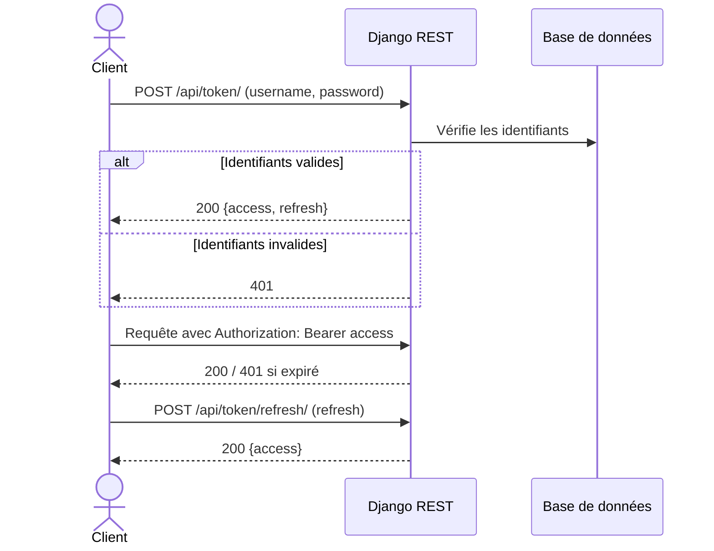
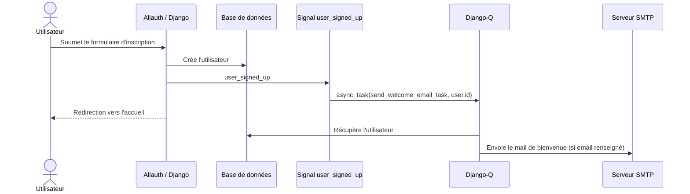
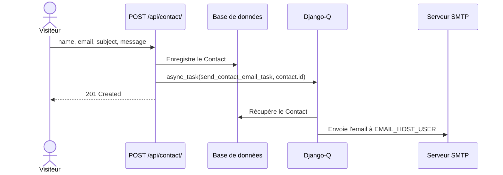
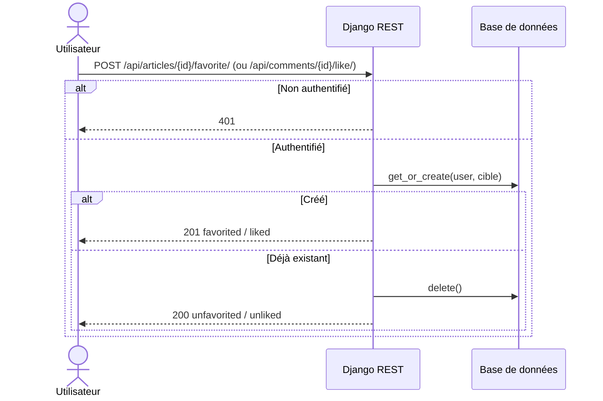
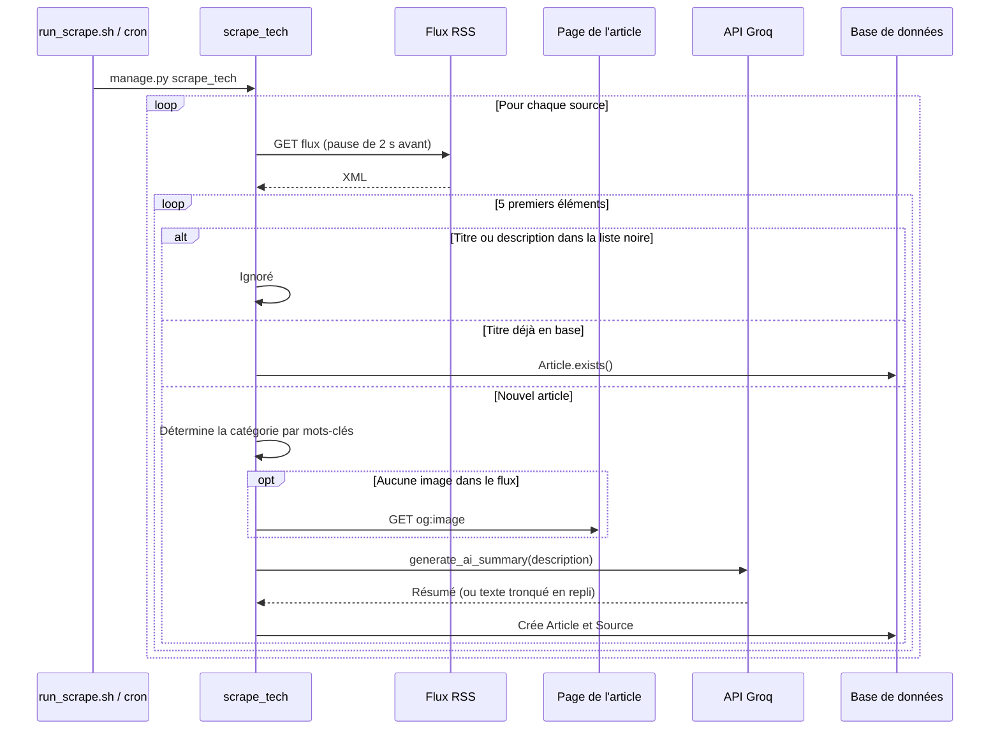
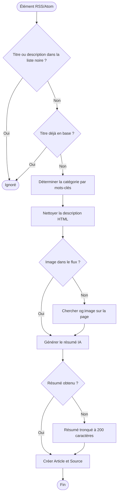
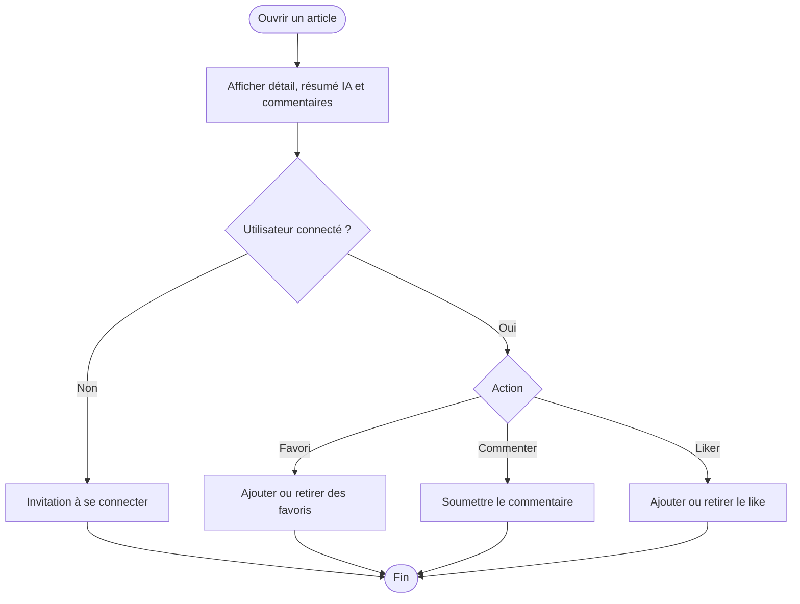

# Diagrammes Tech Pulse

## Séquence : authentification JWT

## Séquence : inscription et mail de bienvenue

## Séquence : formulaire de contact

## Séquence : favori et like (bascule)

## Séquence : collecte des articles (`scrape_tech`)

## Activité : traitement d'un élément de flux

## Activité : consultation d'un article et commentaire

